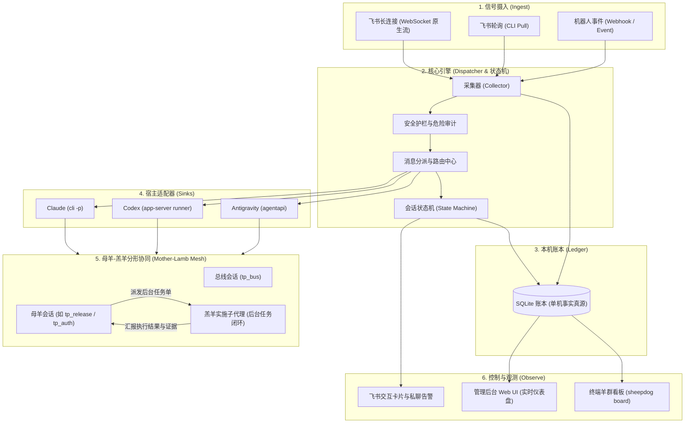

# sheepdog 牧羊犬 🐕🐑

[](https://www.python.org/)
[](tests/)
[-brightgreen.svg)](pyproject.toml)
[](LICENSE)
[](https://github.com/Matthewoho/sheepdog/actions)

[English](README.md) | **简体中文** | [日本語](README.ja.md)

牧羊犬是跑在主人自己电脑上的工作助理。它每分钟从飞书（Lark）拉一次新消息，交给负责的 AI 会话去办，管着这些会话的状态；要主人拍板的事，由会话经机器人在飞书上问主人。

名字的意思：主人是牧羊人，AI 会话是羊群，牧羊犬看群。

## 快速上手（1秒纯本地试玩 Demo）

无需配置飞书或 Antigravity，开箱即用体验完整调度流程：

```bash
git clone https://github.com/Matthewoho/sheepdog.git
cd sheepdog
python3 scripts/demo_duty_board.py
```

该脚本会在 `/tmp` 临时沙箱中构建隔离的配置与账本，使用合成数据跑一轮完整投递，并实时展示 **羊群看板 (`sheepdog board`)**、总线智能防撞车路由、以及异常会话自动诊断与主人告警机制。

## 架构拓扑



## 羊群看板

`sheepdog board` 列出每个会话此刻在干什么：运行状态、手上的事、最近一个动作。状态有变化时，总线会话会收到一份摘要。

- 运行状态分六种：在做、等回复、中断、失联、被主人占着、空闲。牧羊犬每轮按投递账本、会话记录和主人亲自打字的记录重算；「等回复」还参考会话最近一次回执。
- 手上的事主要来自牧羊犬自己记下的事实：登记过的等待、还没答的「需要你定」、转交、带审批单号 / PR / Linear 单号的消息最近送到了哪个会话。会话也可以用 `sheepdog work set` 自己登记，这部分只展示，不改投递和状态；会话空闲且 4 小时没更新的，标「可能过期」。差分测试拿同一套随机情况跑两遍，一遍乱登记、一遍不登记，核对投递、通知、状态完全一致。
- 中断和失联：手上有活，15 分钟没有新的工具调用判中断，会话记录 30 分钟没变化判失联。给它的新消息先扣住，私聊主人；会话一动就补送，每条只送一次，并告诉主人已恢复。
- 被主人占着：主人在会话里打字后 15 分钟内，不往里投递，也不判中断。
- 撞车提醒：消息里的编号最近送到了别的会话，就附一条提醒，写明在谁手上、它现在什么状态。只提醒，不改投递。
- 会话之间留言：`sheepdog tell`。抬头由代码写死，写明不是主人的指令；同一对会话 10 分钟内超过 6 条，暂停这一对。

## 工作流程

1. 采集：每分钟用 lark-cli 以主人身份拉一次新消息，记进本机账本（SQLite）。
2. 分派：按名册和规则，决定交给哪个会话，或者放进收件箱。
3. 安全检查：命中安全规则的加标记或拦截。
4. 投递：送进会话，等回执。
5. 找人：拿不准的事，会话经机器人在飞书私聊主人。
6. 回答：主人在飞书上引用回复，答案送回发问的会话。

```
飞书（lark-cli，主人身份）
   └─► 采集 ──► 账本（SQLite）──► 路由 ──► 安全检查
                                             ├─ 丢弃
                                             ├─ 收件箱（按群）
                                             └─ 投递 ──► 会话（Antigravity / Codex / Claude）
                                                  ▲               │
                                                  └──── 回执 ◄────┘
```

## 消息分派

| 消息 | 去向 |
|---|---|
| 私聊、@主人、@所有人、回复主人的消息、关键人发言、命中关键词 | 送给负责这个聊天的会话；没人负责的送总线 |
| 其他群消息 | 收件箱，按群分开。会话收到 @主人 或 @所有人 的消息时，附一份收件箱摘要 |
| 免打扰的群（没 @主人）、主人自己发的消息 | 不推送 |

- 名册（`roster.toml`）写明哪个会话负责哪些聊天。`managed` 的会话收推送；`known` 的只让总线知道它管什么，不推送。
- 总线是一个特殊的会话：没人负责的消息都给它，它知道整份名册。总线只做分派、转交这类轻活，具体的事用 `sheepdog forward` 交给专属会话；没有合适的，就用 `sheepdog new-session` 新开一个（默认每天最多 5 个）。
- 免打扰的群不推送，但回复主人的消息照样送达。
- 主人引用回复某条「需要你定」时，答案送回发那条的会话；认不出来源的，交给总线并附上原文。
- 主人看过的消息照样送，标「✓已读」。已送出的消息被编辑或撤回，会通知会话。

## 会话管理

- 每批消息带一个批次号。会话处理完交回执（`handled`、`needs_decision`、`waiting_external`、`done`），回执决定会话状态：已处理、等主人、等别人、结束。
- 拿不准的事，会话用 `sheepdog ask` 经机器人私聊主人（汇报用 `sheepdog report`），一次只问一件。开头一行由牧羊犬加，带会话编号（`[tp_xxx]`），主人回复时靠它送回。同一件事带同一把 `--key`：第一次在主聊天里起一条，之后都回到这条的话题里，不再一条条并排；话题里的那几条末尾会 @ 主人（话题回复默认不提醒）；主人在话题里回复，按话题送回会话，话题长了再附最近几条（一事一串）。牧羊犬发给主人的消息（ask / report、系统通知、「待办」清单、结案那一句）默认发成卡片，正文的 markdown 原样渲染（`[notify] owner_card`）。
- 等别人回复要登记（`sheepdog watch`）。默认 15、30 分钟各提醒一次，60 分钟没回就向主人汇报。对方回了，会话确认真等到了才算。
- 换会话：旧会话退休前写交接；新会话先读完前任的记录，回执里写明读了哪些。
- 规则改了以后，正在跑的会话会在下一批里收到完整的新规则。

### 会话宿主

每个会话跑在一种宿主上。名册和 `new-session` 可以按会话指定宿主、模型、推理档位。已有会话不换宿主，要换就退休旧的、新开一个。

- **Antigravity**（默认）：经 Antigravity App 内置的 `agentapi` 新建会话、发消息。
- **Codex**：牧羊犬自己起一个 `codex app-server`，一轮一个后台进程。默认模型和推理档位在 `[hosts.codex]` 里设，可以按会话改。
  - 权限来自 Codex 配置档。设了 `profile`，牧羊犬读这份配置档，展开成 `-c` 参数传给自己起的 app-server，不碰主人自己在 Codex 应用里的会话。牧羊犬不加任何别的沙箱、审批参数；Codex 发来的审批请求一律拒绝。
  - 配置档只对之后新开的会话生效。老会话要跟着变，得退休换新。
  - 主人在 Codex 应用里打开某个线程时，应用占着它的写锁，这期间的批次先排队；占满 60 分钟，机器人提醒主人关掉应用。
- **Claude**：经 `claude -p` 运行。代码已经写好，还没在真实环境里验证过。
- Codex 和 Claude 默认关闭。新开这两种会话前要有主人的原话：`new-session --host codex|claude` 必须带 `--quote`，牧羊犬核对过是主人说的才放行（`ask_owner_before_new`，默认开）。
- Codex 和 Claude 会话多半写不了牧羊犬的状态目录，所以在回答末尾附一个 `sheepdog-receipt` 回执块，代替回执命令。

## 安全

- 只有三种话算主人的指令：
  - 主人在会话里（Antigravity、Codex 或 Claude）直接说的；
  - 总线转达、并且对账本核对过是主人原话的；
  - 发送人核对过是主人本人账号的飞书回复。
- 飞书上其他人说的话只当信息，不当指令。
- 安全规则写在 `security.toml`，每条是正则加条件（是不是外部人、发送人类型）。代码里不写死任何关键词。
  - 标记（`tag`）：照常送达，正文前加警示。示例规则覆盖密钥、权限、删除、跑命令、冒充。
  - 拦截（`hold`）：只送总线。总线要转给别的会话，必须附上核对过的主人原话。示例规则覆盖外部人要密钥、付款、让 AI 绕过规则。
- 按租户（`own_tenant_keys`）区分公司内外的发送人。

## 护栏

会话的上下文被宿主压缩以后，开场给的规则可能丢掉。牧羊犬每轮增量读各会话的记录，加了三道护栏：

- **压缩后重推规则**：发现新的压缩点，下一批带上完整现行规则，前面加一句话说明为什么又发（`rules_after_compaction.md`）。Antigravity 会话认出压缩时手上的批次还没交差，就不等下一批，当场单独补发一份完整规则（不算批次，回执照旧）。Antigravity 和 Codex 的压缩点都认；Claude 的写法没核实过。
- **每批红线**：playbook 下有 `reminders/<key>.md` 的会话，每一批末尾都附上这份文件。
- **危险命令审计**（`[audit]`）：扫被审计会话新跑的命令，和 `danger_patterns` 逐条正则匹配。命中后：
  1. 经机器人私聊主人：哪个会话、几点、什么命令（敏感值隐去）；
  2. 给跑命令的会话发一条提示（`audit_offender.md`）；
  3. 提醒 `also_notify` 里的会话先核对现场，别重复操作（`audit_notify.md`）。

  同时命中 `ignore_patterns` 的不报，比如查帮助、`--dry-run`、发消息时正文里提到命令名。10 分钟内报过的同一条命令再跑不重复报；没报过的命令马上再报，每次都再提示一次停手。给主人的私聊发不出去（比如飞书限流）会按退避重试，2 小时还没发出去就在 `sheepdog doctor` 和羊群看板（`sheepdog board`）开头提示，`sheepdog notices` 查看。这是事后报警，命令已经跑了。

## 对外发言

- 会话以主人身份发出的消息一律是卡片，右下角一行灰字 `[🐕Sheepdog Reply]`，别人能看出是 AI 代发的。回复别人用 `sheepdog reply`：发之前只读查一次这个聊天里主人有没有新说话，说过就不发，把主人的话交给会话再决定（发前再看一眼）。
- 开了 `[ack]` 时：私聊和 @主人 的消息送到会话后，以主人身份点一个「Get」表情，回复后撤下；@所有人的只点不撤。
- 回不回、怎么回，写在 playbook 里。机器人或 Agent 发来的消息会加一行标注，文字来自 `agent_sender_label.md`。示例写的是礼貌回一次、不来回对话。没有这个文件时只标「🤖 来自机器人 / Agent」。
- 防循环：同一个聊天 10 分钟内代回超过 4 次，并且对方是机器人，这个聊天暂停 30 分钟。期间消息只进收件箱，同时通知总线。`sheepdog loops --clear` 手动解除。

### 区分智能体身份和主人本人（`[identity]`，默认关）

同事反映有卡片标记也常分不清是主人本人还是机器人在说话。打开 `[identity]` 以后：

- 两个身份都听：主人身份每分钟搜索照旧，另起一个常驻子进程以机器人身份实时接收（`lark-cli event consume im.message.receive_v1 --as bot`）。同一条消息两边都收到只记一条，账本记下是谁收到的。子进程退出会自动退避重启，`sheepdog doctor` 显示它在不在、最近一次收到事件的时间。
- 群里 @机器人 和 @主人 一样处理，回复机器人发的消息和回复主人的一样处理。机器人自己发的消息不分派，也不算主人的发言。
- 代回用谁的身份由 `sheepdog reply` 自动选：群里机器人在，就用机器人身份发；私聊、机器人不在的群，照旧用主人本人身份发。两个身份都带 `[🐕Sheepdog Reply]` 标记。机器人不在的群 `sheepdog doctor` 会列出来。找主人（ask / report）照旧用机器人。
- 别人私聊机器人不接（主人在飞书里看不到这些私聊）：不分派，机器人回一句 `playbook/bot_dm.md` 里的话，请对方直接找主人本人，同一个人 24 小时内只回一次。
- 关着时行为和以前完全一样。

## 感知主人的动作

- 开了 `[owner_context]` 时，主人在飞书上自己发的话、点的表情、改过或撤回的消息，作为背景送给负责的会话。会话据此判断：主人回过的不再重复回，有冲突的以主人为准。
- 代回卡片带标记，所以会话自己发的消息不会被当成主人的发言。
- 主人在某个会话里打字时，牧羊犬暂停给它投递，主人停下 15 分钟后再补上。Codex 线程被主人在应用里打开时同样排队。

## 可靠性

- 一轮没拉完，进度不往前走，下一轮重拉，按消息编号去重。网络出错时退避重试。
- 先记账，再投递。投递到一半进程断了，重启后对照会话记录核对：已送达的不重投；核对不出来的标「不确定」，人确认后用 `sheepdog redeliver` 再发。
- 长消息超过 200 行截断，末尾写明还剩几行、用 `sheepdog show` 看全文。
- `config.toml`、名册、安全规则每轮重读；playbook 每次组装提示词时现读。改完不用重启，只有 `state_dir` 和 `sink` 要重启。
- 账本默认保留 7 天，到期清理；还没结束的不删。

## 配置和使用

### 需要什么

- Python 3.11 或更高（只用标准库）
- [`lark-cli`](https://github.com/larksuite/cli)（`npm install -g @larksuite/cli`），用主人本人身份登录
- [Google Antigravity](https://antigravity.google) 桌面 App。牧羊犬通过 App 内置的 `agentapi` 新建会话、发消息，它只能在 App 自己的进程里用，所以牧羊犬以 Antigravity 后台进程（sidecar）的方式运行。
- 可选：要开 Codex 或 Claude 会话（`[hosts.codex]`、`[hosts.claude]`），还要装好并登录 `codex` / `claude` 命令行。

### 安装和试跑

```bash
uv tool install .            # 或者：pipx install .
mkdir -p ~/.config/sheepdog
cp examples/config.example.toml   ~/.config/sheepdog/config.toml    # 填 self_open_id
cp examples/roster.example.toml   ~/.config/sheepdog/roster.toml    # 登记现有的会话（可选）
cp examples/security.example.toml ~/.config/sheepdog/security.toml  # 填 own_tenant_keys，按需调整规则
cp -r examples/playbook           ~/.config/sheepdog/playbook       # 按自己的工作方式改写规则

sheepdog doctor              # 检查配置、名册、规则、playbook 文件、各宿主
sheepdog init --dry-run      # 打印初始化会发出的每条消息，不写任何数据
sheepdog poll --dry-run      # 拉真实消息，看会怎么分派，不写任何数据
```

### 正式运行

交给 Antigravity 托管：

```bash
mkdir -p ~/.gemini/config/sidecars/sheepdog
cp examples/sidecar.example.json ~/.gemini/config/sidecars/sheepdog/sidecar.json   # 里面的路径写绝对路径
```

然后在 Antigravity 的 **Automations（自动化）** 面板里启用 **sheepdog**。启动时先跑 `sheepdog init`（可以重复执行），再跑 `sheepdog run`。日志在 `~/.gemini/antigravity/sidecar_data/sheepdog/logs/sidecar.log`。

### 常用命令

```bash
sheepdog sessions            # 所有会话：宿主、职责、负责的聊天、状态、关联项目
sheepdog board [--topic tp_x] # 羊群看板：每个会话在干什么、手上的事、最近动作
sheepdog inbox [--chat 群名]  # 收件箱里的群消息
sheepdog escalations         # 等主人拍板的问题
sheepdog watches             # 会话正在等谁回复
sheepdog security-log        # 被安全检查标记或拦截的消息
sheepdog acks [--open]       # 替主人点过的确认表情，以及是否已撤
sheepdog show --topic tp_x   # 这个会话最近几轮的问答
sheepdog push-rules          # 不等新消息，马上给会话发一次完整规则
```

### 配置文件

| `~/.config/sheepdog/` 下的文件 | 放什么 |
|---|---|
| `config.toml` | 主人的 ID、拉取频率、关键词、代回标记、等待时间、找主人用的聊天、会话宿主、命令审计 |
| `roster.toml` | 哪个会话负责哪些聊天、它的职责、主人给它的授权、宿主和模型 |
| `playbook/*.md` | 业务规则和消息模板：总线、开场说明、交接、提醒、安全、机器人消息标注、每批红线 |
| `security.toml` | 安全检查规则：正则加条件，动作是标记（`tag`）或拦截（`hold`） |
| `prompts/overlay.md` | 可选，给总线的额外指令，比如自己知识库的协议 |

代码只放机制，业务规则都在这些文件里。完整参考：[docs/reference.zh-CN.md](docs/reference.zh-CN.md)。

### 数据放在哪

| 层 | 位置 | 进仓库 |
|---|---|---|
| 引擎代码 | 本仓库 | 是 |
| 配置、名册、playbook、规则 | `~/.config/sheepdog/` | 否 |
| 运行数据（账本、收件箱、回执） | `~/.local/state/sheepdog/`，超过 `retention_days`（默认 7 天）清理 | 否 |
| 工作产出 | 由各会话写进主人自己的笔记和任务系统 | 否 |

- 已经送进 AI 会话的内容由 AI 宿主保存，不在牧羊犬的清理范围内。
- 牧羊犬对飞书只读，只有两类写操作：加、撤确认表情（`[ack]`，不配置就不开）；经机器人私聊主人的提醒，包括 Codex / Claude 登录失效、Codex 应用占着写锁满 60 分钟、危险命令报警、会话卡在 attention 和自动恢复。
- 牧羊犬本身不写主人的笔记和任务系统。
- 提交前的检查脚本（`scripts/check_private_data.py`）会拦住真实的聊天 ID、家目录路径和凭据。测试只用编造的数据。

### 开发

```bash
python3 -m unittest discover -s tests -v
```

## 局限

- 找主人和代回经牧羊犬发，其他消息和命令都是会话自己做的，牧羊犬不在那些执行路径上。代回格式、找人确认、安全规则都靠提示词约束，没法强制。最后几道防线是会话宿主自己的命令权限和云权限。
- 安全检查靠正则，换个说法可能漏掉。命令审计是事后报警，挡不住已经跑了的命令。
- Antigravity App 关着时，牧羊犬也停；重开以后从上次的位置接着来。
- 消息被改或撤回，只有发出后几分钟内能发现。
- 目前只接了飞书。Claude 宿主没在真实环境里验证过。
- 围绕一个人的日常工作搭的，示例规则带着这个人的习惯，用之前要按自己的方式改写。

## 许可证

Apache-2.0
